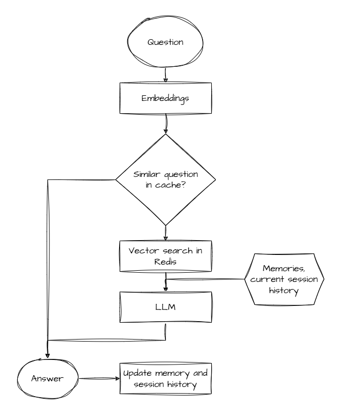

# RTFM
 
Answers questions about Git from the [Pro Git](https://github.com/progit/progit2) book. The book is chunked and embedded into Redis. Each question pulls the nearest chunks by vector search and Gemini answers from those chunks only, citing the file each fact came from. When the chunks don't cover a question, it replies with a fixed refusal sentence.
 
Built while working through the "Build Your Own RTFM For Me Agent" [coding challenge](https://codingchallenges.fyi/challenges/challenge-rtfm-agent/).

## Features
 
- **Grounded answers** with `[source]` citations and a fixed refusal sentence.
- **Semantic cache:** a rephrased repeat question is answered from Redis without a model call.
- **Sessions:** follow-up questions ("how do I delete it?") work. Older messages are summarised and sessions expire after 24 hours.
- **Long-term memory:** facts a user states about themselves are extracted, stored per user and used in later answers.
- **Scoped search:** limit a question to one file or chapter of the book.
- **Streaming:** answers arrive token by token over server-sent events.
- **Failure handling:** if the cache, sessions or memory fail, the answer still comes and a warning is logged. A model failure returns 502, and Redis being down returns 503.
- **Metrics:** cache hit rate, latency, tokens used and estimated cost.


## How it works




## Requirements
 
- Python 3.12+ and [uv](https://docs.astral.sh/uv/)
- Docker (for Redis 8.10.2, which has vector search built in)
- A Gemini API key. Answers always need it. Embeddings can run offline (`EMBEDDING_BACKEND=local`).
## Setup
 
```powershell
git clone https://github.com/progit/progit2 data/progit2
git -C data/progit2 checkout a013e32
docker compose up -d
uv sync
Copy-Item .env.example .env      # macOS/Linux: cp .env.example .env
```
 
Put your key in `.env`, then load the book into Redis:
 
```powershell
uv run --env-file .env ingest.py
```
 
Expect `760 chunks stored` from 84 files. Re-running it re-embeds every chunk, removes chunks that no longer exist, and flushes the cache.
 
## Usage
 
Command line:
 
```powershell
uv run --env-file .env answer.py "How do I undo my last commit?" [session-id] [user-id]
```
 
API (interactive docs at http://127.0.0.1:8000/docs):
 
```powershell
uv run --env-file .env uvicorn api:app --port 8000
Invoke-RestMethod -Method Post -Uri http://127.0.0.1:8000/ask -ContentType "application/json" -Body '{"question": "How do I undo my last commit?"}'
```
 
| Method | Path | Does |
|---|---|---|
| GET | `/health` | `{"status": "ok"}`, or 503 if Redis is down |
| POST | `/ask` | answer as JSON |
| POST | `/ask/stream` | answer as server-sent events: `token`, then `done` or `error` |
| GET | `/sources` | every ingested file |
| POST | `/ingest` | re-run the ingest |
| GET | `/metrics` | cache hits and misses, latency, tokens, estimated cost |
| POST | `/cache/flush` | empty the semantic cache |
| GET / DELETE | `/memories/{user_id}` | list or delete a user's stored facts |
 
`POST /ask` body:
 
| Field | Required | Meaning |
|---|---|---|
| `question` | yes | the question |
| `session_id` | no | continue a conversation. A new one is created and returned if omitted |
| `user_id` | no | read and store long-term memories for this user |
| `source` | no | search only files whose path starts with this, e.g. `02-git-basics` |
 
Reply: `answer`, `sources` (files actually cited), `refused`, `cached`, `remembered` (facts stored from this question) and `session_id`.

## Licence
 
Pro Git is written by Scott Chacon and Ben Straub and licensed [CC BY-NC-SA 3.0](https://creativecommons.org/licenses/by-nc-sa/3.0/). The book is downloaded at setup and not included in this repository.